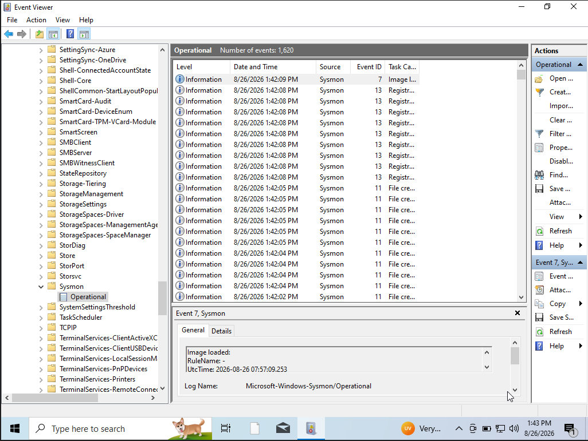
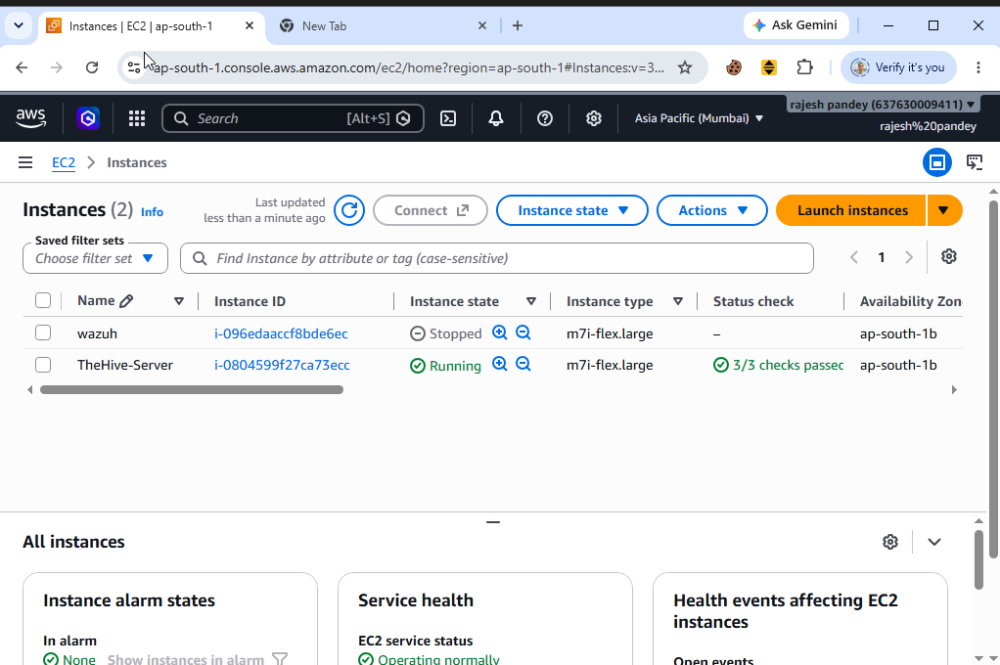
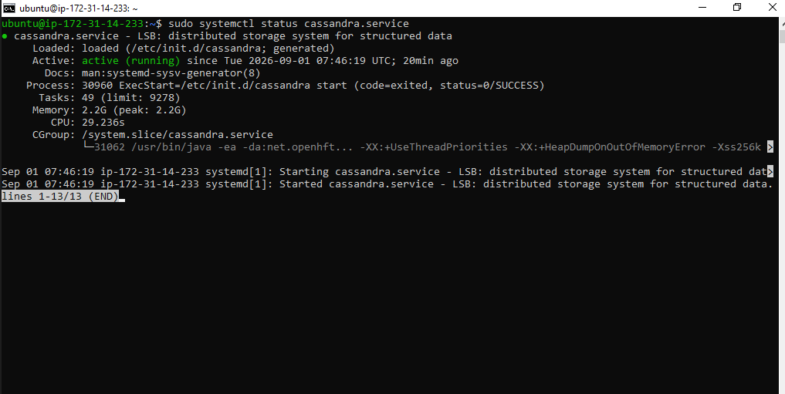
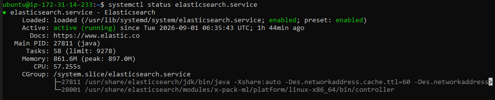
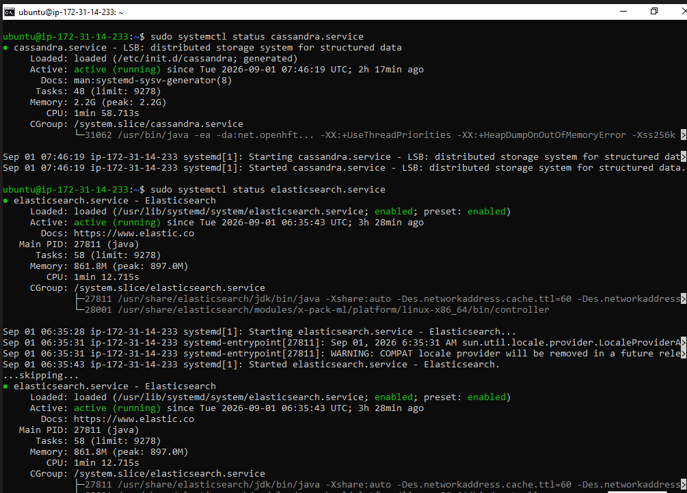
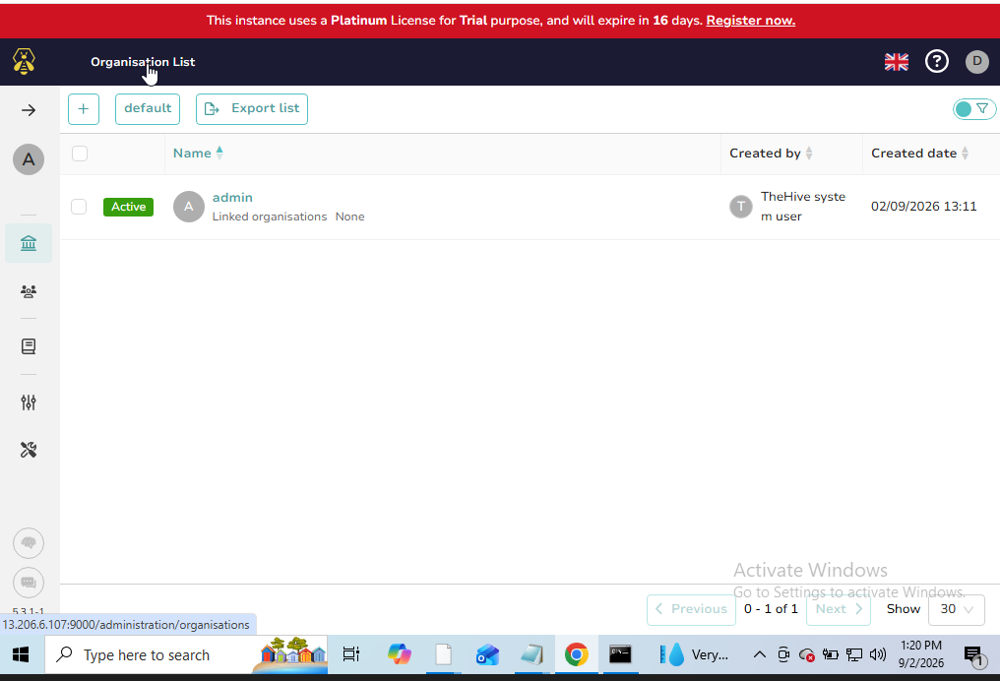

 # Module 02: Infrastructure Provisioning & Core Deployment

## 1. Environment Matrix
* **Windows 10 Client:** Local VM running Sysmon to capture endpoint telemetry.
* **Wazuh Server:** Ubuntu 22.04 on DigitalOcean running Wazuh Manager, Indexer, and Dashboard.
* **TheHive Server:** Ubuntu 22.04 on DigitalOcean running TheHive 5, Cassandra, and Elasticsearch.

---

## 2. Windows 10 & Sysmon Setup
Installed Sysmon with the SwiftOnSecurity configuration to monitor process creation and network events.

  
View Sysmon Setup

   
  
  
  

---

# Module 02: Infrastructure Provisioning & Core Deployment

## 1. Cloud Infrastructure (AWS EC2)
* Deployed Ubuntu 22.04 LTS instances on AWS EC2 to host Wazuh and TheHive platforms.
* Configured security groups to restrict administrative access (SSH, Dashboard, API) to trusted IP addresses.

  
View AWS EC2 Instances

   
  

---

## 2. Wazuh SIEM Deployment
* Installed Wazuh Manager, Indexer, and Dashboard using the automated installation assistant.
* Verified that Wazuh server services are running and accessible via the web interface.

  
View Wazuh Dashboard Access

   
  

---

## 3. TheHive 5 Backend Dependencies & Service Setup
* Configured Apache Cassandra database backend and verified service health.
* Configured and verified Elasticsearch service for log parsing and index storage.
* Initialized TheHive 5 application service linked to Cassandra and Elasticsearch.

  
View Cassandra Status

   
  

  
View Elasticsearch Status

   
  

  
View Enabled Services (Cassandra, Elasticsearch, TheHive)

   
  

---

## 4. TheHive Web UI Verification
* Successfully accessed TheHive web application on port 9000 and created administrative credentials.

  
View TheHive Web Interface

   
  

