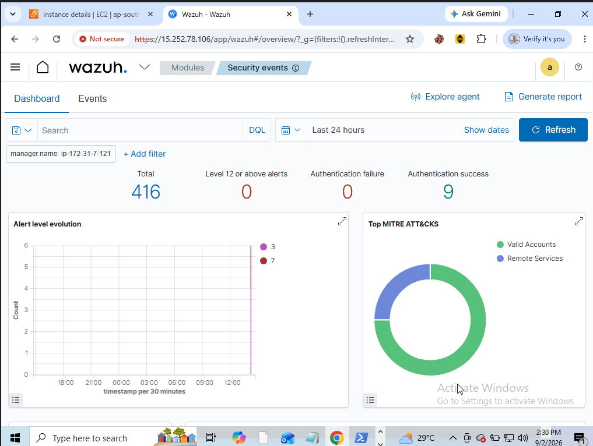
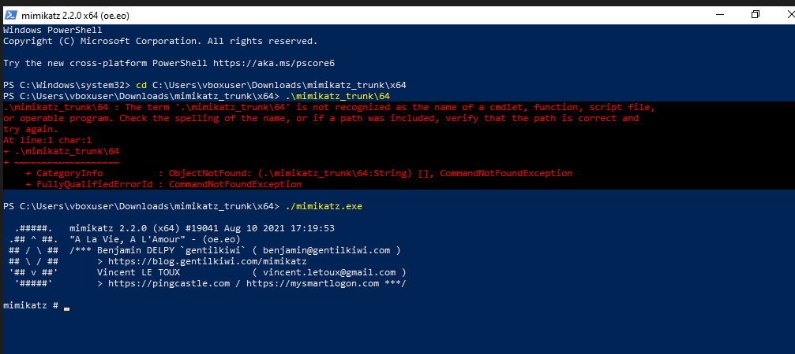

# Module 03: Target Endpoint Configuration & Telemetry Ingestion

## 1. Overview
Setting up the Windows 10 target endpoint, configuring Sysmon for granular event telemetry, and enrolling the Wazuh Agent to forward events to the Wazuh Manager.

---

## 2. Sysmon Deployment
* Installed Microsoft Sysmon on the Windows 10 target using the SwiftOnSecurity configuration file.
* Verified Sysmon event generation in Windows Event Viewer (`Applications and Services Logs/Microsoft/Windows/Sysmon/Operational`).

  
View Sysmon Installation & Operational Logs

   
  

---

## 3. Wazuh Agent Enrollment
* Downloaded and deployed the Wazuh Agent on the Windows 10 client.
* Configured the agent to communicate with the AWS-hosted Wazuh Manager over TCP port 1514.
* Verified active connection and telemetry ingestion on the Wazuh Dashboard.

  
View Wazuh Agent Setup & Ingestion Status

   
  

---

## 4. Adversary Telemetry Generation (Mimikatz)
* Downloaded and staged Mimikatz on the target machine to simulate credential harvesting activity.
* Validated that Sysmon logged the executable staging and process access for SIEM correlation.

  
View Mimikatz Staging on Target

   
  

