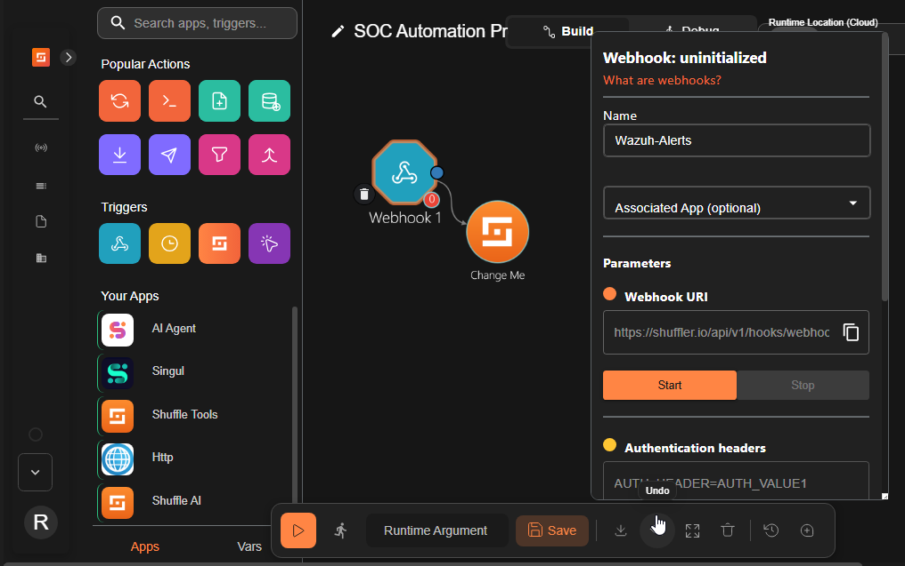
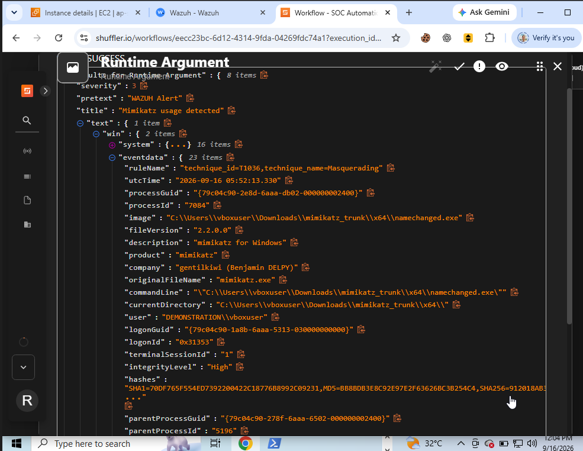
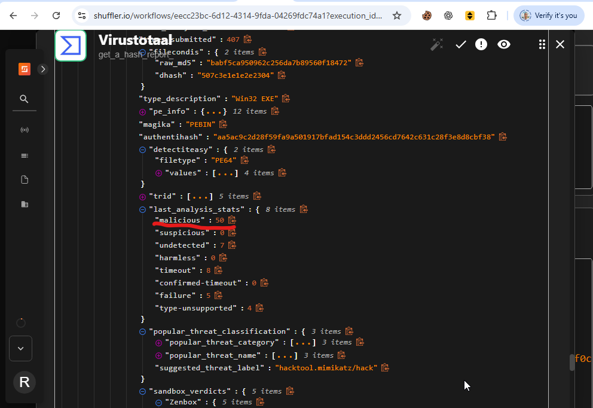
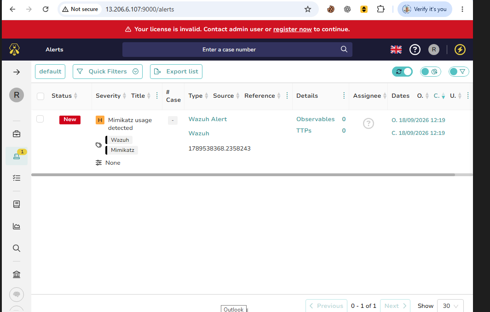
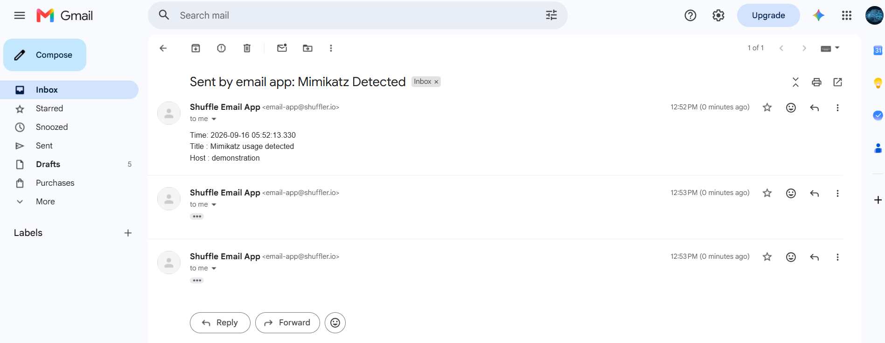
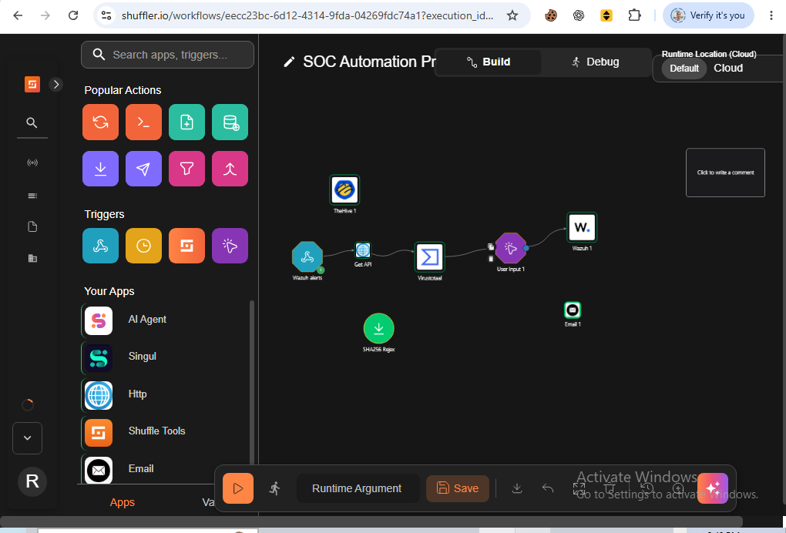

# Module 04: SOAR Workflow Engineering & Incident Automation

## 1. Overview
Building an automated triage and response pipeline in Shuffle SOAR. The workflow ingests alerts triggered by Wazuh, extracts IOCs (file hashes/IPs), checks reputation via the VirusTotal API, opens a case in TheHive, and notifies the SOC analyst with response actions.

---

## 2. Shuffle Workflow Architecture
* Configured a webhook trigger in Shuffle to receive JSON payloads from the Wazuh Manager.
* Designed execution branches to orchestrate enrichment, case logging, and analyst notification simultaneously.

  
View Shuffle Workflow Setup

   
  

---

## 3. Telemetry Ingestion & Parsing
* Wazuh generated detection alerts upon identifying the adversary simulation activity.
* Validated that the full JSON event payload containing process names, file paths, and hashes reached Shuffle.

  
View Ingested Alert Logs in Shuffle

   
  

---

## 4. Threat Intelligence Enrichment (VirusTotal)
* Extracted the SHA256 hash of the staged binary from the alert payload.
* Queried the VirusTotal API to pull threat classification data and detection ratios.

  
View VirusTotal Enrichment Report

   
  

---

## 5. Automated Case Creation in TheHive
* Configured the TheHive integration node in Shuffle to generate a new alert automatically.
* Ingested the host details, severity rating, and enriched observables directly into the case management portal.

  
View Incident Created in TheHive

   
  

---

## 6. SOC Analyst Notification & Final Workflow
* Automated email generation to the SOC analyst containing detection specifics and containment decision options.
* Completed the full SOAR orchestration loop from detection to triage.

  
View Analyst Email Alert

   
  

  
View Completed End-to-End Shuffle Workflow

   
  

